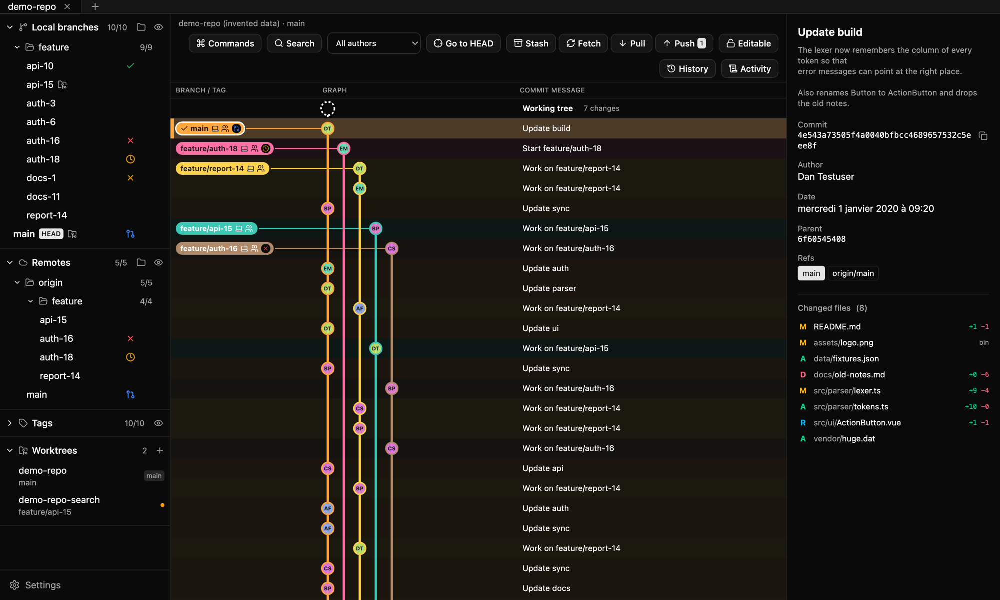

<p align="center">
  
</p>

<h1 align="center">Gitsune</h1>

<p align="center">
  <em>The clever git client where every branch is a tail you can follow.</em>
</p>

<p align="center">
  <a href="LICENSE"></a>
  
  
</p>

<p align="center">
  
</p>

## Why Gitsune

In Japanese folklore a _kitsune_, a clever fox, grows a new tail for every century of wisdom. In Gitsune every tail is a branch: **one colored line per branch, commits as stations, merges as interchanges**. You see where the work went, who did it and what is waiting, without reading a list of hashes.

It is a desktop app (Rust and Vue) that runs the real `git` for every change, so hooks, signing and your credentials behave as in your terminal.

## Highlights

- **A graph you can read.** Stations carry the initials of their author, lines keep their color, and it stays smooth up to about 100,000 commits.
- **Everyday git, with a safety net.** Stage files, hunks or single lines; commit and amend; branches, tags, fetch, pull, push, stash, cherry-pick, revert, reset. Most changes come with an Undo, a history of positions brings back where HEAD was, and every command the app runs is in an activity log.
- **Rebase and merge by hand.** Drag the commits of an interactive rebase and see the result before it runs; resolve conflicts in three panes with next and previous.
- **Pull requests without tokens.** GitHub, GitLab and Azure DevOps through the sign-in of `gh`, `glab` and `az`: build and review badges on the branches, and pull requests created from the app.
- **Made for tickets.** `AB#1234` in a branch name or a message becomes a link to the work item.
- **Fast to drive.** Command palette (Cmd/Ctrl+K), search, focus on an author, worktrees, blame, ten themes.

The complete list, with the decisions behind it, is in [SPEC.md](SPEC.md).

## Download

Packages for macOS (Apple silicon), Linux and Windows are on the [Releases](../../releases) page, with the notes of each version. They are not signed yet: the notes say how to open them. Linux and Windows are experimental.

## Get started

You need [Bun](https://bun.sh), Rust and `git`. More in [docs/DEVELOPMENT.md](docs/DEVELOPMENT.md); how a version is released is in [docs/RELEASING.md](docs/RELEASING.md).

```bash
bun install
bun run tauri dev      # the app, with hot reload
bun run dev            # the interface alone in a browser, on invented demo data
```

macOS is the system it is made and tried on. Linux and Windows are built by the CI and are experimental. Not included yet: submodules, Git LFS and editing files in the application; the macOS package is not signed.

## Made by Agaetis

<p align="center">
  <a href="https://www.agaetis.fr"></a>
</p>

Gitsune is made by **[Agaetis](https://www.agaetis.fr)**, a technology consultancy specialised in data and artificial intelligence, based in Clermont-Ferrand, France.

## License

[MIT](LICENSE), copyright (c) 2026 Agaetis.
